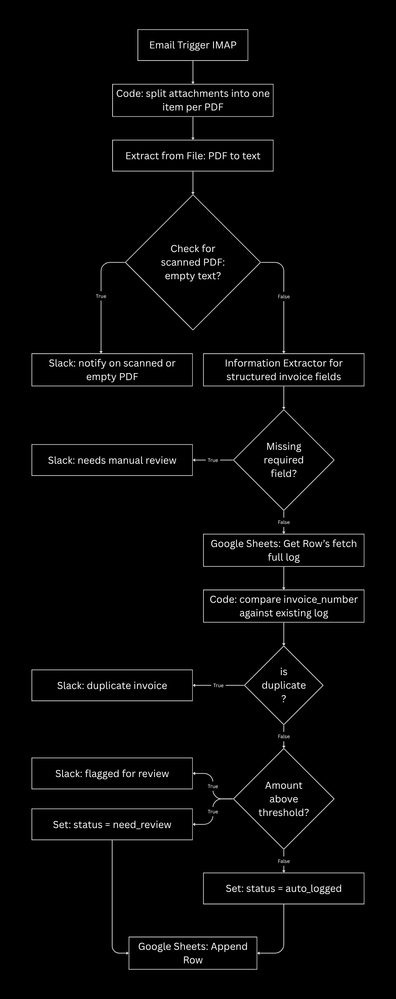
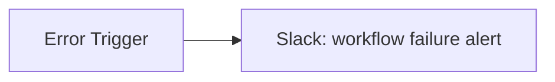
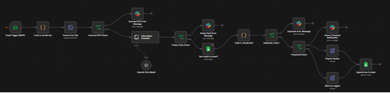
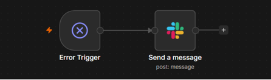
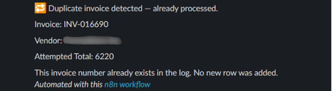
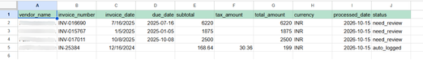

# Invoice Processing Automation (n8n)

An AI-powered workflow that reads invoice PDFs from an email inbox, extracts structured
data with an LLM, validates it against business rules, and logs it to a spreadsheet —
flagging anything that needs a human's attention along the way.

---

## 1. Project Overview and Business Problem

Small and mid-sized businesses commonly receive vendor invoices by email as PDF
attachments. Someone on the team has to open each email, read the PDF, and manually
type the vendor, invoice number, date, and amount into a spreadsheet for bookkeeping.

This is:
- **Slow** — a multi-minute task repeated for every invoice
- **Error-prone** — manual transcription risks typos in amounts and dates
- **Unscalable** — the time cost grows linearly with the business's growth, with no
  efficiency gained

**The business need:** Turn manual invoice bookkeeping into a system that automatically 
reads and logs every invoice, and only pings when something looks uncertain or risky.

---

## 2. Objectives and Key Features

| Objective | How it's addressed |
|---|---|
| Eliminate manual data entry for routine invoices | Gmail trigger → AI extraction → auto-logged to Google Sheets |
| Never silently lose or duplicate an invoice | Duplicate-invoice-number check against the existing log before writing |
| Never silently process bad data | Missing-required-field check; scanned/unreadable PDF safeguard |
| Keep a human in the loop for risk | Amount-above-threshold flag, routed to a Slack alert |
| Capture and notify Errors | A dedicated Error Trigger workflow alerts on any failure anywhere in the pipeline |

**Key features:**
- Handles **multiple PDF attachments per email**, processed independently
- **Three-way validation**: missing fields, duplicate invoice numbers, amount threshold
- **Human-in-the-loop alerting** via Slack for anything that needs review
- **Safety net for scanned/image invoices** — flagged for manual review rather than
  silently producing bad or guessed data (see Limitations, Step-8)
- **Separate error-handling workflow**, so a failure anywhere (bad PDF, API outage)
  triggers an alert instead of failing invisibly

---

## 3. Workflow Architecture and Node Sequence



**Separate workflow — Error Handler:**

Linked to the main workflow via its Settings → Error Workflow field, so any
unhandled failure in the main pipeline triggers this one automatically.

### Node-by-node summary

| # | Node | Type | Purpose |
|---|---|---|---|
| 1 | Email Trigger (IMAP) | Trigger | Watches the inbox for new invoice emails |
| 2 | Code (split attachments) | Code (JS) | Normalizes 0–N attachments into one item per PDF, binary field always named `data` |
| 3 | Extract from File | Core | Pulls text out of each PDF |
| 4 | IF: scanned PDF check | Logic | Catches empty text before it reaches the AI step |
| 5 | Information Extractor | AI | Structures the invoice text into fields (vendor, invoice #, date, amounts) |
| 6 | IF: missing required field | Logic | Checks vendor, invoice number, total are present |
| 7 | Google Sheets: Get Row(s) | Action | Fetches the full invoice log once per run |
| 8 | Code (duplicate check) | Code (JS) | Flattens the AI output and flags `is_duplicate` |
| 9 | IF: is duplicate | Logic | Routes known invoice numbers to an alert |
| 10 | IF: amount threshold | Logic | Flags high-value invoices for review |
| 11 | Set (×2) | Action | Stamps `status` as `auto_logged` or `need_review` |
| 12 | Google Sheets: Append Row | Action | Writes the validated invoice to the log |
| 13 | Slack (×3) | Action | Alerts for: missing field / scanned PDF, duplicate, needs review |
| 14 | Error Trigger + Slack | Separate workflow | Alerts on any unhandled failure |

---

## 4. Tools and Technologies Used

| Tool | Role |
|---|---|
| **n8n** (self-hosted, Docker) | Workflow orchestration engine |
| **Docker Desktop + WSL2** | Runs n8n locally in an isolated container |
| **Gmail (IMAP)** | Invoice intake — email trigger with an app-password connection |
| **OpenAI (`gpt-4o-mini`)** | Structured data extraction from invoice text |
| **Google Sheets** (Service Account credential) | Lightweight invoice log / database |
| **Slack** (Bot token) | Human alerting for exceptions |
| **n8n Code node (JavaScript)** | Attachment normalization; duplicate-check logic |

---

## 5. Setup and Configuration Instructions

### Prerequisites
- Docker Desktop installed and running (Windows requires WSL2 enabled)
- A Gmail account with 2-Step Verification on, and an **App Password** generated
- An OpenAI API key
- A Google Cloud project with the Sheets API enabled, and a **Service Account** JSON key
- A Slack app with a **Bot Token** (`chat:write` scope), installed to your workspace

### 1. Start n8n
```bash
# docker-compose.yml already included in this repo
docker compose up -d
```
Open **http://localhost:5678** and create your owner account on first run.

### 2. Configure credentials in n8n
| Credential | Type | Where it's used |
|---|---|---|
| IMAP | Email Trigger (IMAP) | Gmail address + App Password, `imap.gmail.com:993`, SSL on |
| OpenAI API | OpenAI Chat Model | Your OpenAI secret key |
| Google Sheets (Service Account) | Get Row(s) / Append Row | Paste the service account email + private key from your downloaded JSON |
| Slack (Access Token) | Slack nodes (×3, plus the error workflow) | Your `xoxb-...` bot token |

**Important:** the service account's email must be invited as an **Editor** on your
Google Sheet (Share → paste its email), or the Sheets nodes will fail with a
permission error.

### 3. Prepare the Google Sheet
Create a spreadsheet named `Invoice Log` with this header row:
```
vendor_name | invoice_number | invoice_date | due_date | subtotal | tax_amount | total_amount | currency | processed_date | status
```

### 4. Point the trigger at the right mailbox
In the Email Trigger (IMAP) node, set **Mailbox** to a dedicated label/folder
(e.g. `Invoices`) rather than the main inbox, to keep testing predictable.

---

## 6. Importing the Workflow JSON Files

This repo includes two exported workflow files:
- `invoice-automation-workflow.json` — the main pipeline
- `invoice-automation-error-handler.json` — the error-handling workflow

**To import each one:**
1. In n8n, go to the workflows list
2. Click **+ Add workflow → Import from File** (or drag the `.json` file directly
   onto the empty canvas)
3. Select the file
4. The full node layout and connections load automatically

**After importing, you must reconnect credentials manually** — the exported JSON
deliberately does **not** include API keys or tokens, for security. Each node that
needs a credential will show a warning until you select (or recreate) the
corresponding credential from Step-5.

**Then, link the two workflows:**
1. Open the main workflow → **⋯ menu → Settings**
2. Set **Error Workflow** to the imported error-handler workflow
3. Activate the error-handler workflow (top right → Publish)

---

## 7. Test Cases and Observed Results

| # | Scenario | Expected behavior | Observed result |
|---|---|---|---|
| 1 | Single new invoice, all fields present, under threshold | Auto-logged, no alert | ✅ Logged with `status: auto_logged` |
| 2 | Single new invoice, amount above threshold | Logged, flagged, Slack alert sent | ✅ Logged with `status: need_review`, alert received |
| 3 | Invoice missing a required field (tested: blank `total_amount`) | Routed to alert, not logged | ✅ Routed to `True` branch, Slack alert sent |
| 4 | Email with 2 new invoice attachments | Both processed and logged independently | ✅ Both invoices logged with correct, non-mixed data |
| 5 | Email with 1 new + 1 duplicate invoice | New one logged; duplicate alerted, not logged | ✅ Correct branch for each; one row appended, one alert sent |
| 6 | Email with 2 duplicate invoices | Both alerted, neither logged | ✅ Two Slack alerts, no new rows |
| 7 | Scanned/image-based PDF (near-empty extracted text) | Routed to manual-review alert, not sent to the AI extractor | ✅ Routed correctly on text-length check |
| 8 | Forced node failure (error-workflow test) | Error-handler workflow fires, Slack alert sent | ✅ Alert received with workflow name and failing node |

**Two notable bugs found and fixed during development** (documented here because the
debugging process itself is part of the engineering story):
- **Item-pairing failure**: a per-item Google Sheets lookup silently collapsed items
  when "Always Output Data" triggered on a batch with zero matches, breaking n8n's
  item-linking (`.item` reference). Fixed by fetching the sheet once (`Execute Once`)
  and comparing explicitly in a Code node instead of relying on per-item lookups.
- **Silent nested-output bug**: the Information Extractor node wraps its results in
  an `output` property, not flat on the item. A duplicate check that didn't account
  for this returned `is_duplicate: false` for every invoice, with no error thrown.
  Found via targeted debug fields in a Code node's output, not an error message.

**It takes 6 minutes to enter the four invoice details manually, while the automated workflow completes the same task in 42 seconds.**

---

## 8. Known Limitations and Future Improvements

| Limitation | Why | Possible improvement |
|---|---|---|
| Scanned/image-only PDFs aren't processed by AI | Extract from File only reads embedded text; a scanned PDF has none | Route the "looks scanned" branch to a vision-capable model (e.g. GPT-4o) that can read the PDF directly.|
| No itemized line-item extraction | Nested, multi-level schemas are less reliable with a small model like `gpt-4o-mini` | Add a dedicated line-items extraction pass once the flat-field pipeline is proven reliable |
| Duplicate check re-fetches the entire sheet every run | Simplicity over scale, appropriate for a small demo dataset | For a high-volume inbox, move the log to a real database with an indexed lookup |
| Single currency assumption downstream | Not normalized/converted | Add currency conversion if invoices span multiple currencies |
| WhatsApp alerting not implemented | Requires Meta Business verification — too heavy for this scope | Documented as a production option; Slack used instead for the working demo |
| No automated test suite | Workflow tested manually, scenario by scenario | Consider n8n's workflow testing features, or a scripted set of sample emails run through a test mailbox |

---

## 9. Screenshots and Case Study






---

## Project Structure

```
Invoice-Processing-Automation/
├── docs
    └── (setup-guide.md)
└── screenshots/
    └── (1.workflow.png)
    └── (2.scanned_pdf.png)
    └── (3.error_message_alert.png)
    └── (4.missing_required_field_alert.png)
    └── (5.duplicate_alert.png)
    └── (6.above_threshold_alert.png)
    └── (7.error_handling_workflow.png)
    └── (8.invoice_log.png)
    └── (Workflow_Architecture_Node_Sequence.png)
├── workflows
    └── (Invoice Automation.json)
    └── (Invoice Automation - Error Handler)
├── docker-compose.yml
├── README.md

```
